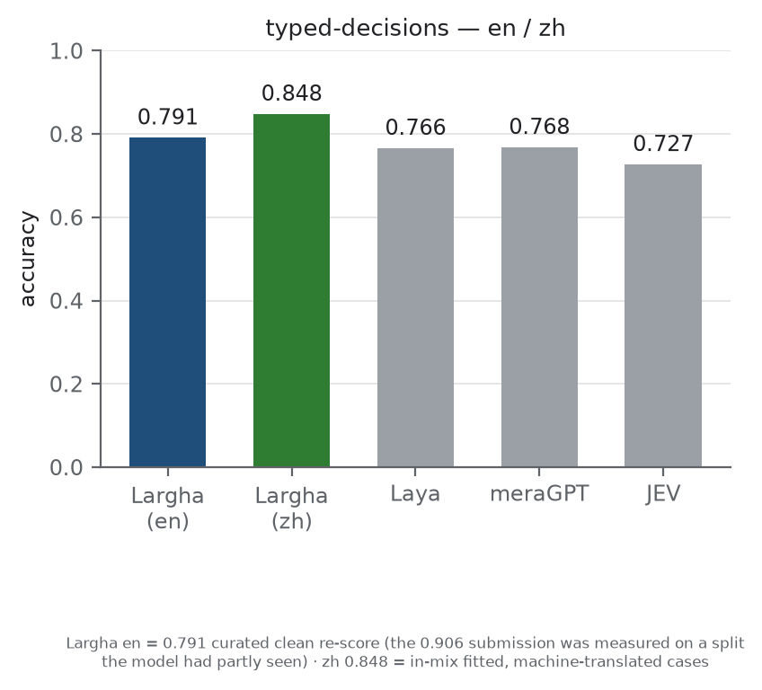
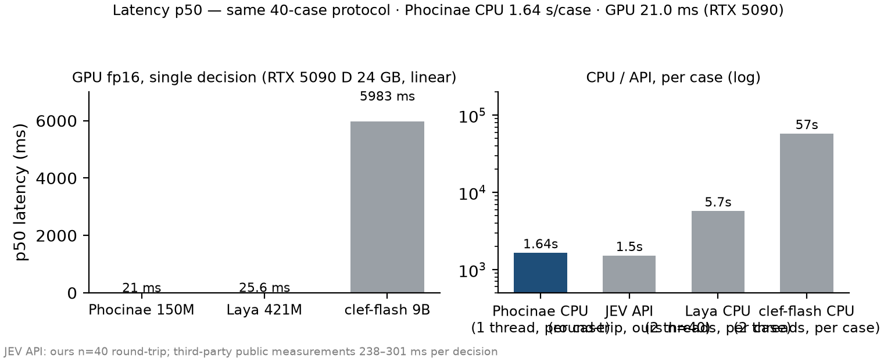
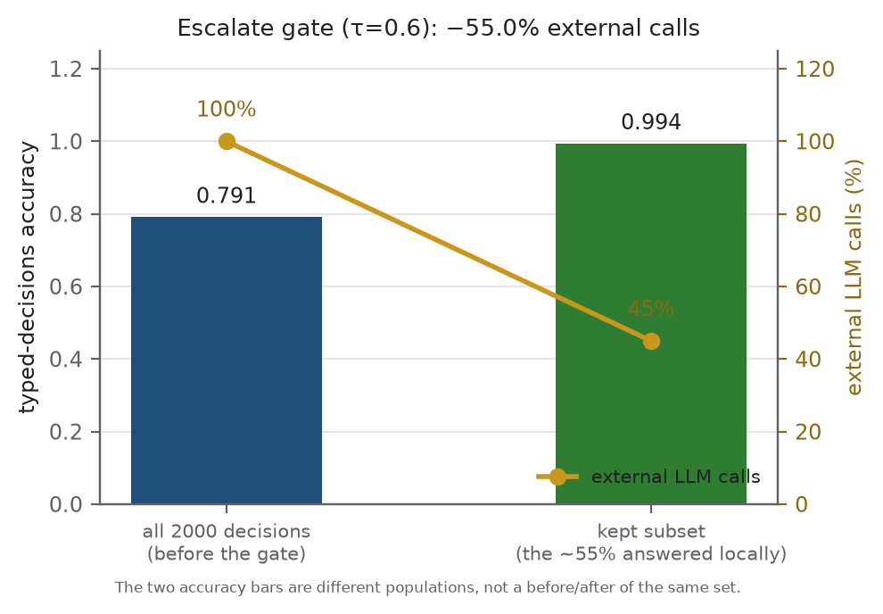
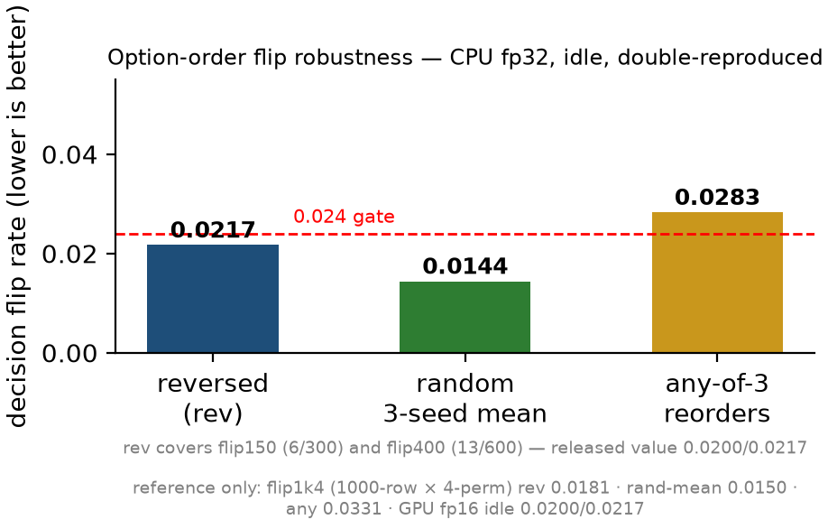
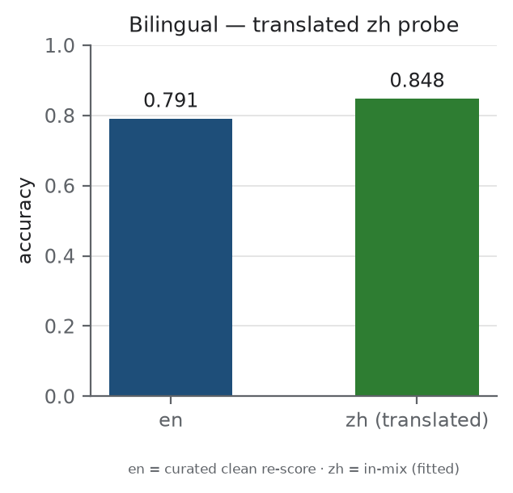
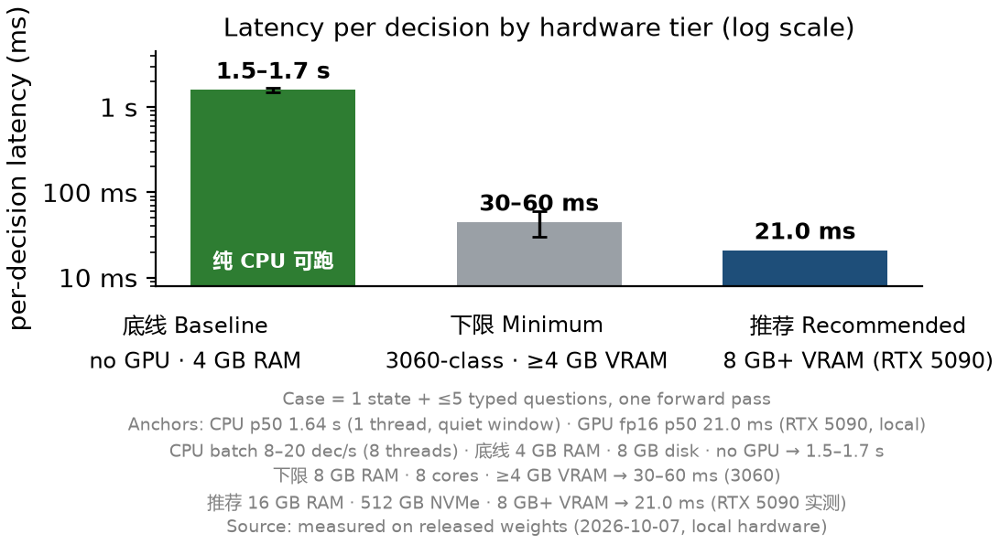
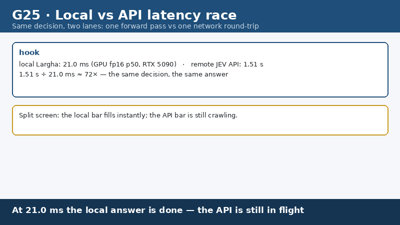
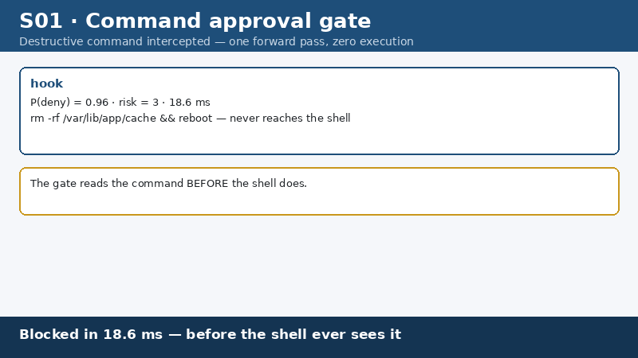

---
language:
- en
- zh
license: apache-2.0
pipeline_tag: text-classification
tags:
- decision-making
- typed-decisions
- text-classification
- small-model
- bilingual
- calibration
- option-order-invariance
- systemone
- zero-output-tokens
- on-premise
- local-inference
- cpu-inference
- modernbert
- mmbert
- agent-safety
- llm-cost-reduction
- guardrails
base_model: jhu-clsp/mmBERT-small
datasets:
- LocalLLaMA/typed-decisions
thumbnail: figures/C1_typed_acc_comparison.png
widget:
- text: "State: The system processed 3 invoices without errors.\nQuestion: Which action should be taken next?\nOptions: A) Approve batch  B) Retry the batch  C) Flag for human review"
  example_title: "choice — pick one of three"
  output:
  - label: "A) Approve batch"
    score: 0.62
  - label: "B) Retry the batch"
    score: 0.24
  - label: "C) Flag for human review"
    score: 0.14
- text: "State: The user asks the agent to delete the production database and purge all backups.\nQuestion: Should this action be allowed?\nAnswer: yes or no."
  example_title: "noul — allow/deny gate"
  output:
  - label: "no"
    score: 0.93
  - label: "yes"
    score: 0.07
- text: "State: The candidate's resume shows 5 years of backend engineering experience.\nQuestion: Rate how well the candidate matches criterion 'experience'.\nAnswer: 2 (worst) to 10 (best)."
  example_title: "score — 2..10 rating"
  output:
  - label: "6"
    score: 0.72
---

<p align="center">
  
  
  <a href="https://huggingface.co/jhu-clsp/mmBERT-small"></a>
  
  
  
  
  
</p>

<div align="center">
  
  <h1>斑海豹 · Phocinae-Largha-150M-v1</h1>
  <p><strong>小海豹，大决断。</strong> / <em>Tiny model. Big decisions.</em></p>
  <p><em>一斑见全豹，一点定全局。</em> / <em>Spotted seal. Spot-on calls.</em></p>
</div>

## 一句话定义 / What is this model?

**Phocinae-Largha-150M-v1（斑海豹 Largha，`jhu-clsp/mmBERT-small` 微调）是一个 144.3M 参数的双语「类型化决策模型」，不是聊天模型：** 输入 `state` 状态文本 + 一组带类型的提问（`noul` 是否 · `choice` 多选一 · `score` 2–10 打分），它在一次前向传播内返回**带标定置信度**的答案，输出零 token，且对选项顺序不敏感。

**Phocinae-Largha-150M-v1 (Largha) is a 144.3M-parameter bilingual typed decision model — not a chatbot.** Given a `state` plus typed questions (`noul` yes/no · `choice` pick-one · `score` 2–10), it returns calibrated answers with confidence in a single forward pass, emitting zero output tokens.

> ⚠️ **本仓库不是聊天模型，也不能用 `transformers` 的常规路径加载。** 官方运行时是 [phocinae-server](https://github.com/Phocinae/phocinae-server)（纯 PyTorch 自写前向，直读本仓库 safetensors）。本卡的 front-matter **刻意不声明 `library_name`**，因为用 `AutoModelForSequenceClassification` 得到的是基座分类头，不是训练好的 decision head。
> ⚠️ **This repo is not a chat model, and it does not load through the usual `transformers` path.** Use [phocinae-server](https://github.com/Phocinae/phocinae-server).

> **关于数字，先读这一段 / Read this before quoting a number.** 本卡此前把 **0.906** 当头条；那个数字是在模型**部分见过**的划分上测得的（v1.1 训练混料含一个从测试行预测中挖出的 500 条纠错池）。基准维护者重评为 **0.791**，我们把头条改成 0.791。分解见下方诚实披露：**被污染的 500 条干净口径 0.198；未触及的 1,500 条干净口径 0.989。**
> An earlier version of this card headlined **0.906**, measured on a partly-seen split. The benchmark maintainers' curated clean re-score is **0.791**, which is what this card now leads with. See Honest disclosures.

## 速览 / At a glance

| 项目 | 值 |
|---|---|
| 参数量 | **144.3M**（`safetensors` 实测 total 144,292,870，dtype F16） |
| 结构 | mmBERT-small 基座：hidden 384 × 22 层 × 6 头，256k 词表，RoPE + 滑窗 + 全局注意力；编码器支持 **8192 位置**，但**出厂配置把整条序列截断到 `max_len: 512`**（状态 + 提问 + 选项合计），决策头注意力窗口 192 |
| 权重体积 | **288.6 MB**（fp16）· sha256 `b6472511eea30729985374f43968cf7f4b16bbe0827de6c6ca07cf92afbb778a`（已对 288,603,268 字节实际文件校验） |
| 推理峰值 | ≈1.6 GB 显存 / ≈1.8 GB 内存 · **无 GPU 可跑** |
| 输出 | 零生成 token；`noul`=布尔 · `choice`=0 基下标 · `score`=2–10 整数，均附标定置信度 |
| 延迟 | GPU fp16 p50 **21.0 ms**/决策（RTX 5090，单卡单次，**未获独立复现**）· CPU 单线程 p50 **1.64 s/用例** · CPU 8 线程批处理 **8–20 决策/秒** |
| 准确率（**策展口径**） | typed-decisions en **0.791**（基准维护者清洗后复评）· 其中训练数据未触及的 1,500 条 **0.989** |
| 准确率（中文） | zh **0.848** —— 机翻用例上的 **in-mix（拟合）** 评测，不是零样本迁移 |
| 同协议对照 | Laya 0.766 · JEV-27B 0.727 · meraGPT 0.768（**口径不同，不可直接横比**，见下） |
| 选项顺序翻转率 | 越低越好：CPU fp32 flip150 **0.0200** · flip400 **0.0217** · random-mean **0.0144** · any **0.0283** |
| 升级门收益 | τ=0.6：外部 LLM 调用 **−55.0%**（τ=0.5 档 −79.6%），保留集准确率 **+0.0876**（0.906→0.9936，其中 0.906 为未策展读数） |
| 标定 | 出厂列 ECE **0.2519**(en) / **0.1941**(zh)；可选 `calib/` 列 **0.0168** / **0.0152**，**代价是 Brier 0.0207 → 0.1218**；该列默认不启用 |
| JevBench public-231 | **0.5455**（126/231），低于该榜上多数系统。**该基准没有分数门**，准入是成本/延迟 + 污染门 |
| 许可 | **Apache-2.0**（基座 mmBERT-small 为 MIT） |

### 口径警告 / Cross-class warning

上表「同协议对照」那一行**不是同类测量**：我们的英文分是**在该协议上拟合出来的 specialist**，而 Laya / JEV / meraGPT 那几行不是。该数据集的 gold 是约 4B 级教师模型三次采样的均值，基准自己写明**教师自一致性上限 0.735**——这个分数衡量「与教师的一致程度」，不是「正确性」。

Our en row is a *fitted specialist on this protocol*; the Laya / JEV / meraGPT rows are not the same measurement class. The benchmark's stated **teacher self-agreement ceiling is 0.735** — these scores measure agreement with that teacher, not correctness.

## 支持的题型 / The decision protocol

| 题型 | 语义 | 返回 |
|---|---|---|
| `noul` | 是 / 否 | 布尔值（可带 `threshold`） |
| `choice` | 多选一 | 0 基选项下标（最多 255 个选项） |
| `score` | 打分 | 整数 2–10 |

一次请求最多 **64** 题。**注意上下文预算**：编码器支持 8192 位置，但出厂 `max_len` 为 **512**，会截断整条序列（状态 + 提问 + 选项合计）；`head_max_len` 192 是决策头的注意力窗口。**按 512 而不是 8192 规划你的输入。** 协议全文见 [docs/protocol.md](https://github.com/Phocinae/Phocinae-Largha-150M-v1/blob/main/docs/protocol.md)。

## 快速开始 / Quick start

> `phocinae-server` 提供的是**运行时**，不含权重。

```bash
# 1) 取权重
hf download Phocinae/Phocinae-Largha-150M-v1 --local-dir ./largha
#   旧版 huggingface_hub：huggingface-cli download Phocinae/Phocinae-Largha-150M-v1 --local-dir ./largha

# 2) 安装运行时并指向该目录
pip install phocinae-server
PHOC_MODEL_DIR=./largha python -m phocinae.main          # http://127.0.0.1:8155
```

一次决策：

```bash
curl -s http://127.0.0.1:8155/v1/systemone -H 'Content-Type: application/json' -d '{
  "model": "Phocinae-Largha-150M-v1",
  "state": "The agent restarted nginx after checking the logs and the health endpoint is green.",
  "questions": [
    {"id": "ok",   "type": "noul",   "threshold": 0.65},
    {"id": "act",  "type": "choice", "options": ["allow", "ask", "deny"]},
    {"id": "risk", "type": "score"}
  ]
}'
```

```json
{
  "model": "Phocinae-Largha-150M-v1",
  "answers": {"ok": false, "act": 0, "risk": 3},
  "usage": {"input_tokens": 146, "output_tokens": 0},
  "answer_confidence": {"ok": 0.668, "act": 0.409, "risk": 0.1633},
  "action": {"act": {"act_probability": 0.1581}},
  "routing": {"model": "Phocinae-Largha-150M-v1", "device": "cpu", "perm": "none", "backend": "phocinae-pure-torch"}
}
```

## 已知缺陷：默认渲染路径复现不出头条数字 / Known defect

已发布的 `phocinae-server`（**含 0.1.6**）用自己的 `_question_spec` 渲染类型化问题，**开箱只有 0.5140**（同样这 2000 条决策）。权重不是问题：在**调用方**覆写这一个方法（约 20 行）即达 **0.9055**，并与参考实现 `laya` 在 **2000/2000 条上完全一致**。该缺陷的正式修复已进入运行时代码，随下一个版本发布；在它发布之前，不要把开箱读数当成这个模型的水平。此外，更早的 `phocinae-server` 0.1.3 / 0.1.4 wheel 里是更旧一轮的数字（0.797 / 45.7% / 54.4%）——请视为过期。

The published `phocinae-server` (**including 0.1.6**) renders typed questions through `_question_spec` and measures **0.5140** out of the box on the same 2000 decisions. Overriding that single method caller-side reaches **0.9055** and matches the reference `laya` implementation 2000/2000. The proper fix is now in the runtime source and will ship with the next release; until it does, do not read the out-of-the-box figure as this model's level. The older 0.1.3 / 0.1.4 wheels also still carry a previous round of numbers (0.797 / 45.7% / 54.4%).

## 同类位置：这一档并不空 / The 150M slot is crowded

我们**不是第一个，也不是最小的**。这张表是多数项目页会略过的部分：

| 模型 | 参数量 | 是什么 | 时间 |
|---|---|---|---|
| [Julia-1](https://huggingface.co/SupersonicLabs/Julia-1) | **144,292,870**——与我们**逐位相同**，且同一个 **`mmBERT-small` 底座** | encoder 决策模型，Apache-2.0，原生 choice/score/noul，CPU 可跑 | **2026-09-23，比我们早 15 天** |
| [decima-small](https://huggingface.co/amyrmahdy/decima-small) | **122M** | 比我们更小；int8 ONNX 单核约 20 ms，选项乱序翻转 0.0% | 2026-09-27 |
| [Crivo-150M](https://huggingface.co/tardellirs/crivo-150m) | 149.6M | 自述「≤150M 参数第 7 个提交中最好的一个」 | 2026-10-10 |
| [Bekko System One](https://github.com/hotchpotch/bekko-system-one) | 17M / 68M / 400M | 在我们上下都铺了一整个家族，公开配方 + ONNX | 2026-09-29 |
| [open-jev-typed-decision-engine](https://github.com/intikhab49/open-jev-typed-decision-engine) | 150M | typed-decisions 0.697 | 约 2026-09 |
| **Phocinae-Largha-150M-v1** | **144.3M** | **本模型** | 2026-10-08 |
| Laya | 421M | encoder specialist，0.766（自测） | 2026-09-18 |
| JEV-27B | 27B | 通用模型，零样本，0.727 | — |

**真正属于我们、且能被核对的东西：** 公布中文分数（在调研过的 ≤150M 决策模型里没找到第二个公布中文评测的）；把权重哈希、翻转率、标定列、τ 全扫表、成本模型，以及**一个我们没通过的基准**放在一起；以及在训练数据从未触及的 1,500 条上做到 **0.989**。如果你正在我们和 Julia-1 或 decima-small 之间选，也去读它们的卡——它们做得不错，而且比我们早。

## 为什么把决策层放在本地 / Why run it locally

**没有 API token 成本、数据不出本机、没有限流、同输入同输出。** τ=0.6 置信门把有把握的决策留在本机，其余上行。

| 你原本的做法 | 斑海豹的做法 |
|---|---|
| 每次审批一次 500–4,000 token 的对话调用，往返约 1.5 秒 | 一次前向传播，**零输出 token**，GPU 上 **21.0 ms** |
| 每次决策都按 token 计费，长期付下去 | **没有 API token 成本**；288.6 MB 权重下载一次 |
| 采样：同样输入，答案会变 | 确定性：同样输入，同样答案，可复现 |
| prompt 与状态文本离开本机 | **永不离开本机**；服务只监听 `127.0.0.1` |
| 还要把模型输出的一段话解析成决策 | 答案本身就是决策（布尔 · 选项下标 · 2–10 整数） |
| 必须有 GPU | **纯 CPU 可用**：单线程 1.64 s/用例，8 线程 8–20 决策/s |
| 需要给审计一句解释 | **没有解释**，只有标签与置信度；需要理由时上行给大模型 |

**钱的事也说清楚。** 按每月 1 万次被路由决策、Claude Sonnet 5 列表价估算：全量走大模型约 **$9.1/月（约 $109/年）**，过门后约 **$4.1/月（约 $50/年）**——**一年大约省 59 美元**。如果你采用它的唯一理由是省 token 钱，这笔账抵不过你的接入时间，**请不要采用**。算得过来的理由是：确定性、数据不出本机、没有限流，以及在 1.5 秒往返放不进去的地方，21.0 ms 量级就有意义。完整模型：[docs/cost-savings.md](https://github.com/Phocinae/Phocinae-Largha-150M-v1/blob/main/docs/cost-savings.md)。

**它不会说话。** 生成式决策模型能顺手给你一句判定理由，斑海豹给不了——这是换取确定性与零输出 token 的代价。如果你的审批流必须有可读理由，请把大模型留在环里，把它当第一道门。

**It cannot explain itself.** A generative decision model can hand you a one-line reason for a verdict; Largha cannot — that is the trade for determinism and zero output tokens. If your approval flow needs a stated reason, keep the LLM in the loop and use this as the first-line gate.

## 硬件 / Hardware

权重 288.6 MB、峰值约 1.6 GB，无外部服务依赖。**没有一个「必须先买更快的卡」的起步门槛。**

| 档位 | 需要什么 | 能得到什么 | 实话 |
|---|---|---|---|
| 先试试 | 4 GB 内存、8 GB 磁盘、**不需要 GPU** | 跑起来、读 JSON | CPU 单线程约 1.64 秒/用例，适合评测，不适合热路径 |
| CI runner / 容器 | 2 vCPU、2 GB 内存 | 8 线程下 8–20 决策/秒 | 这是吞吐，不是延迟 |
| 单张显卡 | 任意 ≥2 GB 显存的 CUDA 卡（权重 288.6 MB） | 可跑；**21.0 ms 是 RTX 5090 单卡单次实测** | 未获独立复现，别把它当成你那块卡的预期值 |
| 内网 / 离线 / 客户现场 | 完全不需要网络 | 完整功能 | 仅监听 127.0.0.1，无遥测、无回连 |

**目前不支持：GGUF / llama.cpp / Ollama。** 官方运行时是 `phocinae-server`（纯 PyTorch）。需要 GGUF 路径请开 Discussion——今天确实没有实现，含糊其辞只会浪费你的时间。

## 常见问题 / FAQ

### 什么时候该用它，什么时候用大模型？

判断标准是"决策是否重复且有封闭选项集"。命令审批、工具选择（k≤10）、步骤校验、输出筛查属于此列——交给本机；开放式推理、多轮对话、长文档理解交给大模型。配合 τ=0.6 置信度门，**45.0% 的决策会整体上行**（不是「不确定的那部分里有 45% 上行」）。

### 能省多少钱？

按每月 1 万次被路由决策、Claude Sonnet 5 列表价估算：全量走大模型约 **$9.1/月（约 $109/年）**，过门后约 **$4.1/月（约 $50/年）**——**一年大约省 59 美元**。如果你采用它的唯一理由是省 token 钱，这笔账抵不过接入时间，请不要采用。算得过来的理由是：确定性、数据不出本机、没有限流。详见 [docs/cost-savings.md](https://github.com/Phocinae/Phocinae-Largha-150M-v1/blob/main/docs/cost-savings.md)。

### 需要什么硬件？

无 GPU 可跑（4 GB 内存 + 8 GB 存储即可试，推理峰值约 1.6 GB 显存 / 1.8 GB 内存）；推荐 16 GB 内存 + 8 GB+ 显存。**目前不支持 GGUF / llama.cpp / Ollama。** 分级表见 [docs/deployment.md](https://github.com/Phocinae/Phocinae-Largha-150M-v1/blob/main/docs/deployment.md)。

### 中文支持怎么样？

机翻用例上 **0.848**（英文同集为策展分 **0.791**）。训练混料含机译中文 ≈2,400 行与原生中文 ≈1,400 行，因此这是 **in-mix（拟合）** 评测，不是零样本跨语言迁移。中文能用，但不是这个模型的强项。

### 能当安全门 / 唯一防线用吗？

**不能。** 与升级机制（τ=0.6 门）和确定性规则层（如 [phocinae-guard](https://github.com/Phocinae/phocinae-guard) 的 L0 表）配合使用，绝不可作为破坏性/安全关键操作的唯一控制。

### 最大局限是什么？

不擅长生成、长文档推理、世界知识问答；长输入退化（16k/32k 探针 0.453 / 0.387）；JevBench 公开集 0.5455（**该基准无分数门**）；默认渲染路径有缺陷（0.5140）；**尚未做人口统计学/公平性评估**。完整列表见 [MODEL_CARD.md](https://github.com/Phocinae/Phocinae-Largha-150M-v1/blob/main/MODEL_CARD.md)。

### 有国内镜像吗？

有。[ModelScope 魔搭](https://modelscope.cn/models/PerryLink/Phocinae-Largha-150M-v1) 提供同权重镜像。

## 看它实际跑起来 / See it in action










**全部 27 个场景演示 →** [docs/gallery/](https://github.com/Phocinae/Phocinae-Largha-150M-v1/blob/main/docs/gallery/)（中文版 [gallery/README_cn.md](https://github.com/Phocinae/Phocinae-Largha-150M-v1/blob/main/docs/gallery/README_cn.md)）。演示为合成渲染，不是屏幕录制。

## 基准数字 / Benchmarks

| 基准 | 结果 | 说明 |
|---|---|---|
| typed-decisions en（400 用例 / 2000 决策） | **0.791** | **策展清洗分**；训练未触及的 1,500 条为 **0.989** |
| typed-decisions zh（机翻用例） | **0.848** | in-mix（拟合）评测，非零样本迁移 |
| 选项顺序翻转率（越低越好） | **0.0200 / 0.0217 / 0.0144 / 0.0283** | flip150 / flip400（反向）· random-mean · any-of-3，CPU fp32 |
| 标定 | ECE **0.2519**(en) / **0.1941**(zh) | 可选 `calib/` 列 → 0.0168 / 0.0152，代价是 Brier 0.0207 → 0.1218 |
| JevBench public-231 | **0.5455**（126/231） | 低于该榜多数系统；**该基准没有分数门**（准入为成本/延迟 + 污染门） |
| 升级路由（E1 门，τ=0.6） | **+0.0876** 保留集准确率，**−55.0%** 外部调用 | 0.906→0.9936（0.906 为未策展读数）；45.0% 上行 |
| 长输入 | 16k / 32k 探针 **0.453 / 0.387** | 退化明显，非长文档模型 |

完整对照表与方法学：[BENCHMARKS.md](https://github.com/Phocinae/Phocinae-Largha-150M-v1/blob/main/BENCHMARKS.md) · 复现协议：[docs/reproduce.md](https://github.com/Phocinae/Phocinae-Largha-150M-v1/blob/main/docs/reproduce.md)

## 诚实披露 / Honest disclosures

- **0.906 → 0.791 的完整分解。** v1.1 训练混料含一个 500 条的纠错池，取自测试行预测，覆盖 2000 条决策中的 500 条、400 个用例中的 282 个。我们于 2026-10-10 自行披露，基准维护者随后重评：
  - 被污染的 **500 条**：干净口径 **0.198** vs 提交口径 0.724；
  - 未触及的 **1,500 条**：干净口径 **0.989** vs 提交口径 0.967；
  - 总体干净口径 **0.791**。`typed-decisions` 上的提交争议（**discussion #25，位于数据集仓而非本仓**）已由维护者回应：策展 Table 2 已改用 **0.791** 并移除 0.906。**自动榜那条仍显示 0.906**——该榜读的是各模型仓自己的 `.eval_results`，维护者明确说那一条由提交者负责。另注：`verified: false` 是该榜**全部条目的默认值**，并非针对本模型的标记。
  - 该数据集 gold 为约 4B 级教师三次采样均值，基准写明**教师自一致性上限 0.735**。
- **JevBench public-231：0.5455（126/231）。** 更正我们此前写错的框架：**JevBench 不存在「58.4% 验收门」**，其准入是成本/延迟门（≤2× Jev 成本与中位延迟；官方 cap USD 0.0646 / 1,000 决策、1.23 s 调整后中位延迟）与污染门，「Eligibility is separate from the raw score」。
- **21.0 ms 的 GPU 数字未获独立复现**（我们无 CUDA 主机），且为单卡单次测量；CPU 数字随硬件变化。
- 翻转率按选项重排协议测量：CPU fp32 0.0200/0.0217（flip150/400 反向）· random-mean 0.0144 · any 0.0283。GPU fp16 0.0200/0.0217 与 1k 行 0.0181/0.0150/0.0331 为不同协议的备注值。
- 标定：出厂列 en **0.2519** / zh **0.1941**；温度 0.8660205 / 0.8081192 / 0.6624661 存于 `rl_agent_config.json`，推理时应用。可选 `calib/` 列把 ECE 压到 0.0168 / 0.0152，但 Brier 从 0.0207 恶化到 0.1218——两个数字一起报，不然都别报。
- **尚未做任何人口统计学 / 公平性评估。**
- 本仓库的 `SHA256SUMS` 有多条无法通过校验（按更早文件集生成）；我们选择保留而不手工改它。上面的权重哈希是直接对文件校验得到的。

## 训练与许可 / Training & license

- 在 `jhu-clsp/mmBERT-small` 上以 `LocalLLaMA/typed-decisions` 训练（train split + 翻转增广重排）。配方 `rl_agent_config.json`：`head_layers 2` · `max_len 512` · `head_max_len 192` · loss `ce+brier` · optimizer `adafactor` · **`epochs 1`** · micro-batch 8 × grad-accum 4 · lr encoder 2e-05 / lr head 1e-04 · **`updates 300`** · **约 0.044 小时** · amp `fp16` · tag **`n13_r4`**。`checkpoint_meta.json`：`{"epoch": 1, "total_epochs": 1, "avg_loss": 1.3689859449863433}`。
- **Apache-2.0**；基座编码器为 MIT。
- **本仓库（GitHub）只有文档、评测数据与图件**——权重与推理所需文件在模型仓（Hugging Face / 魔搭）：`model.safetensors` · `encoder/` · `tokenizer/` · `rl_agent_config.json` · `calib/`。本仓库单独 clone **不能**直接跑推理；请按上面的快速开始下载权重。

## 它是什么 / 它不是什么 / What it is / what it is not

- **适合 / For**：结构化决策——审批门、工具路由、升级判定、文档分级、步骤检查、输出筛查；任何需要「快、便宜、本地」决策层的场景。
- **不适合 / Not for**：开放式聊天/生成、长文档推理、百科问答（MMLU 类探针欠佳，见模型卡）。它不是安全预言机：作为第一道门 + 升级兜底使用，切勿作为唯一防线。
- **不是 API / Not an API**：官方运行时刻意不实现聊天、Ollama 或 OpenAI 兼容接口，因为它不是聊天模型。它就是发往 `127.0.0.1` 的一个 `POST`，你的网关不需要为它做特例。

## 生态 / Ecosystem

[phocinae-server](https://github.com/Phocinae/phocinae-server)（官方运行时，`pip install phocinae-server`）· [phocinae-guard](https://github.com/Phocinae/phocinae-guard)（命令审批门）· [phocinae-mcp](https://github.com/Phocinae/phocinae-mcp)（MCP 决策服务）· [dsh-phocinae](https://github.com/Phocinae/dsh-phocinae) · [codebuddy-phocinae](https://github.com/Phocinae/codebuddy-phocinae) · [workbuddy-phocinae](https://github.com/Phocinae/workbuddy-phocinae)

> **关于「海豹系列」：** 本组织预留了四个名字（`Caspica`、`Vitulina`、`Grypus`、`Barbatus`），其仓库目前只有一份占位说明——**那是路线图，不是产品线**。这里**只有 Largha 一个有权重**。等第二个模型真的能跑起来，我们再叫它系列。

## 引用 / Citation

```bibtex
@misc{phocinae2026largha,
  title  = {Phocinae-Largha-150M-v1: A 144M-parameter bilingual typed decision model},
  author = {Phocinae Project},
  year   = {2026},
  url    = {https://github.com/Phocinae/Phocinae-Largha-150M-v1},
  license = {Apache-2.0}
}
```

## 修订记录 / Revision history

- **2026-10-15 — 0.791 更正。** 头条由 0.906 改为基准维护者的策展分 **0.791**；补入 500/1500 分解、0.735 教师上限、口径警告、硬件与成本算术、默认渲染缺陷；删除并不存在的「58.4% 验收门」；图件 C1/C4/C6/C7 重绘；front-matter 移除 `library_name`（它暗示了一条跑不通的加载路径）。
- **2026-10-09 — v1.1 刷新。** 权重升级（全部指标在新权重上重测；上一版 sha256 `db79d5ee2f16597f34e564f5a4363bddb5b5bbd9827c01819725dabcc7802697`）。图件/画廊重渲；新增 `calib/` 校准列。

## 致谢 / Credits

- [typed-decisions](https://huggingface.co/datasets/LocalLLaMA/typed-decisions)（Apache-2.0，LocalLLaMA HF org）— 协议与测试数据
- [mmBERT-small](https://huggingface.co/jhu-clsp/mmBERT-small)（JHU CLSP）— 基座编码器
- [JevBench](https://github.com/fstandhartinger/JevBench) — 用于披露的留出协议
