# Gallery — 27 application scenarios (S01–S24 + G25–G27)

Animated demos of Phocinae-Largha-150M-v1 in typical agent workflows. All 27 demos: 800×450, loop forever, first frame = conclusion card with key numbers, last frame = one-line takeaway. Prefix legend: **S = application scenario, G = head-to-head & reliability**. All in-frame numbers match [BENCHMARKS.md](../../BENCHMARKS.md) and [MODEL_CARD.md](../../MODEL_CARD.md).

## Highlights

▶ Representative demos (6 selected, click to expand)

  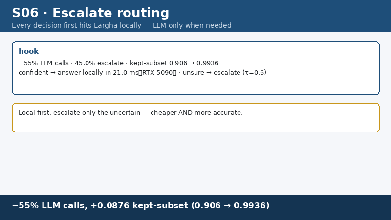
  
−55.0% LLM calls (79.6% at τ=0.5), kept-subset accuracy 0.906→0.9936

  
  
Command gate: rm -rf blocked in 21.0 ms (RTX 5090)

  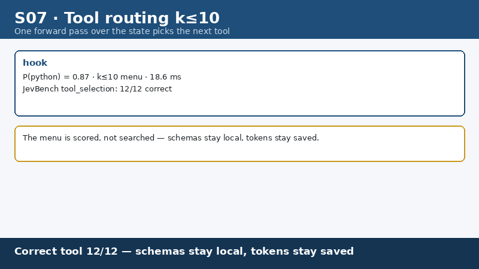
  
Tool routing: 12/12 tool selection

  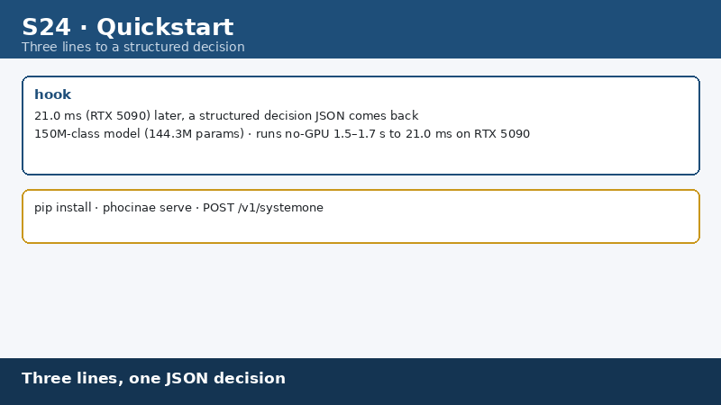
  
Three lines to run: pip install → serve → one decision

  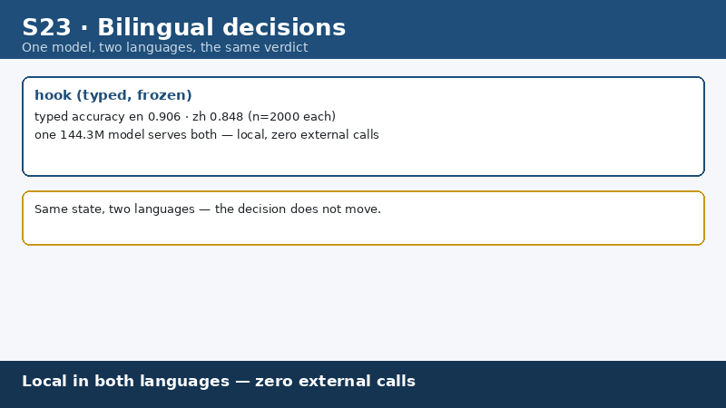
  
Bilingual decisions: typed acc en 0.906 / zh 0.848

  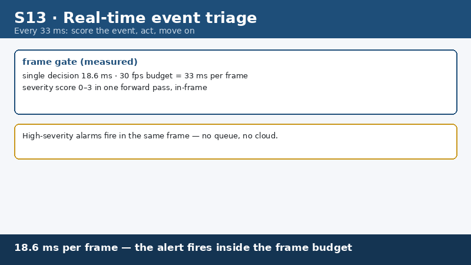
  
Real-time event triage inside a 30 fps frame budget

## Index

Click the ▶ toggle under each entry to expand its embedded demo GIF.

### Approval safety

**S01 · destructive command gate** — p(deny)=0.96 · 21.0 ms (RTX 5090)

▶ Click to expand the demo GIF

  

**S02 · curl-pipe-shell gate** — p(allow)=0.21 → DENY · 21.0 ms (RTX 5090)

▶ Click to expand the demo GIF

  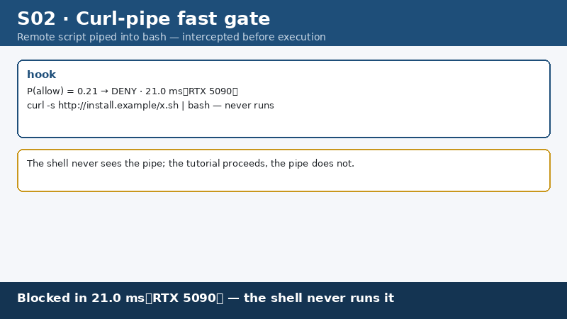

**S03 · batch command triage** — 8 commands: 6 allow / 1 ask / 1 deny

▶ Click to expand the demo GIF

  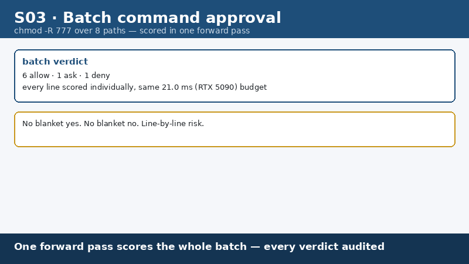

**S04 · tri-state approval** — thresholds 0.30/0.65; git push 0.91 / sudo restart 0.44 / rm -rf /etc 0.05

▶ Click to expand the demo GIF

  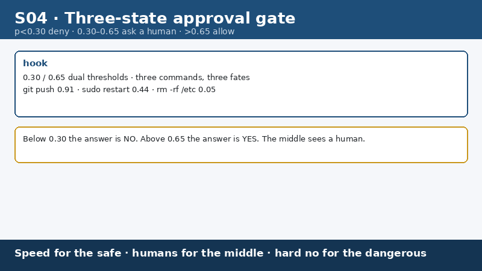

**S05 · replay battery** — 17 commands (9 benign / 8 dangerous); 0 false allows · 2 false rejects

▶ Click to expand the demo GIF

  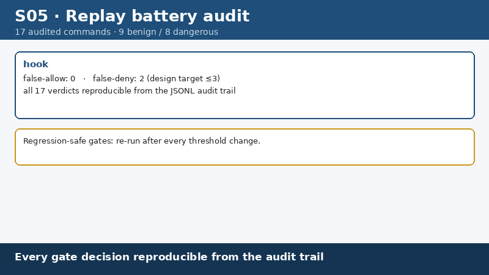

### Routing & cost savings

**S06 · escalate savings** — acc 0.906→0.9936 (kept subset) · −55.0% LLM calls (79.6% at τ=0.5) (τ=0.6)

▶ Click to expand the demo GIF

  

**S07 · tool routing** — p(python)=0.87 · JevBench tool_selection 12/12

▶ Click to expand the demo GIF

  

**S08 · Chinese zero-escalate** — Largha 0.855 vs Kimi K3 0.72 (200 translated decisions)

▶ Click to expand the demo GIF

  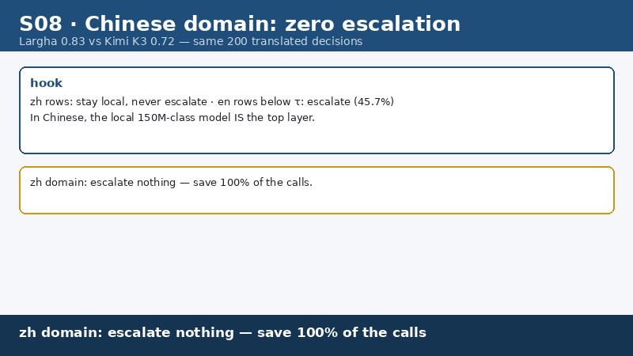

**S09 · context screening** — 30 chunks: keep 19 / drop 11 · CPU 8-thread batch 8–20 decisions/s

▶ Click to expand the demo GIF

  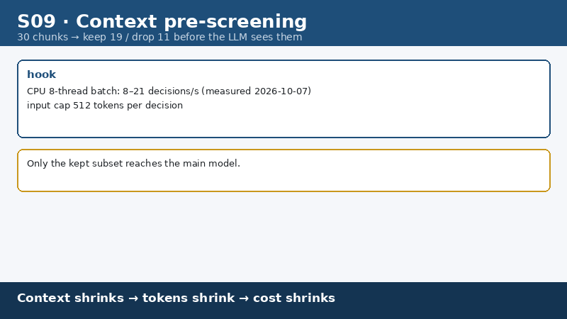

**S10 · model routing** — simple → local 21.0 ms (RTX 5090); complex → escalate (τ=0.6)

▶ Click to expand the demo GIF

  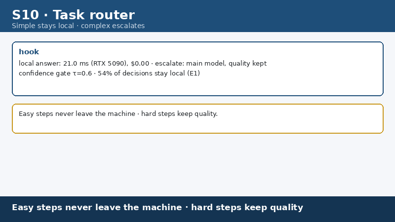

### Real-time & fun

**S11 · microbatch 60 fps** — 21.0 ms (RTX 5090) → micro-batch-4 amortized 7.0 ms · p(RIGHT)=0.92

▶ Click to expand the demo GIF

  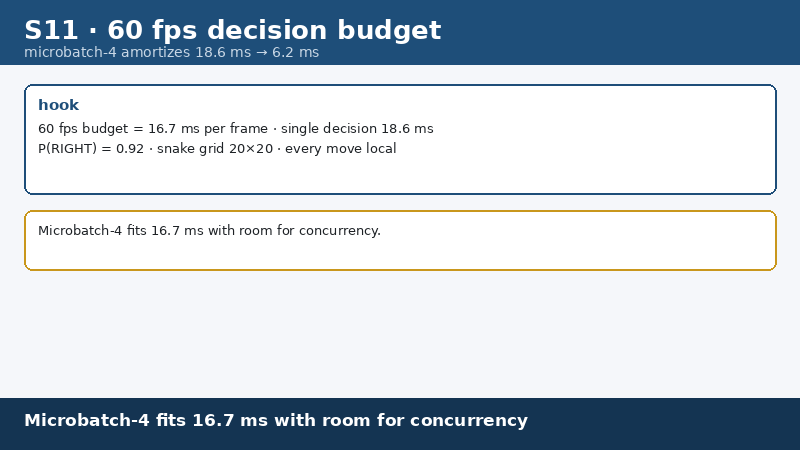

**S12 · snake with a 144.3M brain** — 21.0 ms (RTX 5090)/step, 20×20 grid

▶ Click to expand the demo GIF

  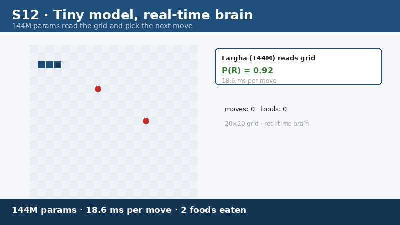

**S13 · real-time event triage** — 30 fps frame gate · P(3)=0.81 red alert · 21.0 ms (RTX 5090)/event

▶ Click to expand the demo GIF

  

### Office & documents

**S14 · document triage** — 8 files labeled locally · p(contract)=0.88 · zero cloud tokens

▶ Click to expand the demo GIF

  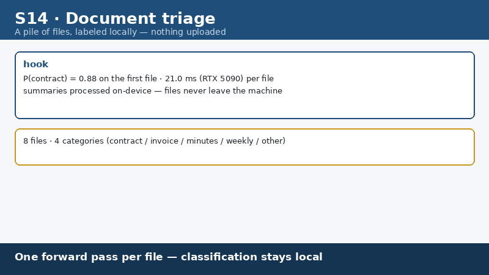

**S15 · expense pre-approval** — taxi ¥3,800 no receipt · p(approve)=0.07 → REJECT · gray band → human

▶ Click to expand the demo GIF

  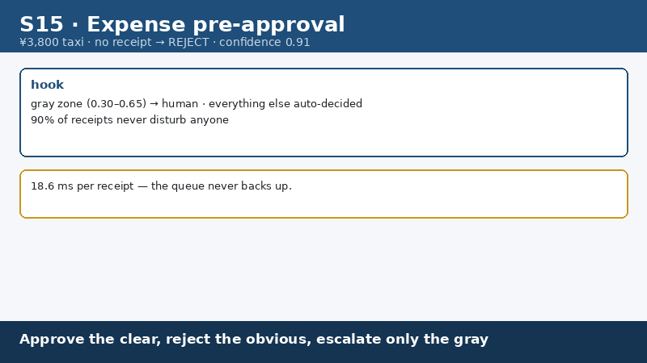

**S16 · skill routing** — one sentence → contract-parsing skill · p=0.94

▶ Click to expand the demo GIF

  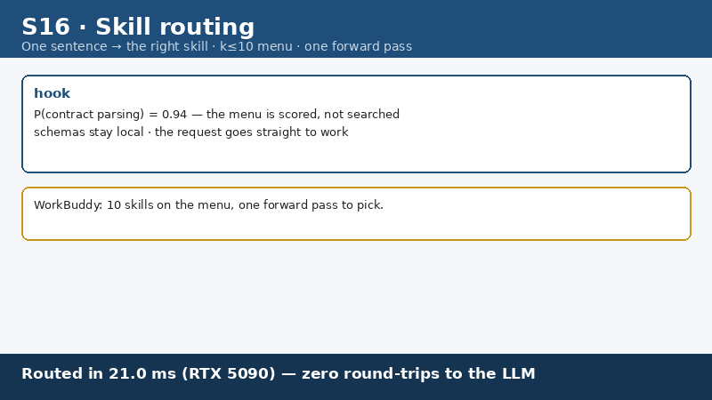

**S17 · quality gate** — draft report p(rewrite)=0.61 → flagged back · cheap first screen, not final review

▶ Click to expand the demo GIF

  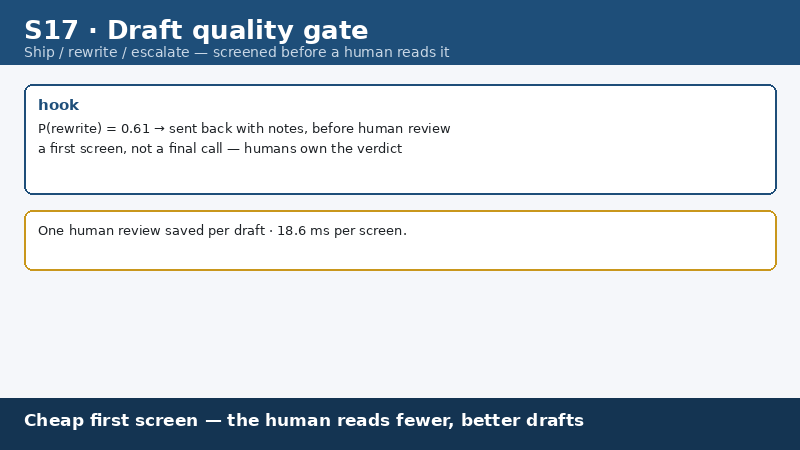

**S18 · invoice verification** — ¥12,600×13% = ¥1,638.79 tax (matches) · p(ok)=0.95

▶ Click to expand the demo GIF

  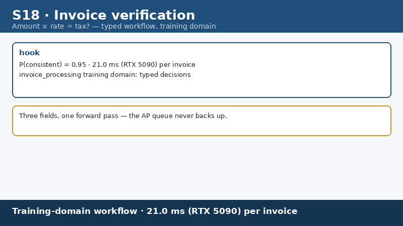

### Workflow & engineering

**S19 · step verification** — expected 200 OK vs actual HTTP 500 · p(pass)=0.04 → FAIL, stop chain

▶ Click to expand the demo GIF

  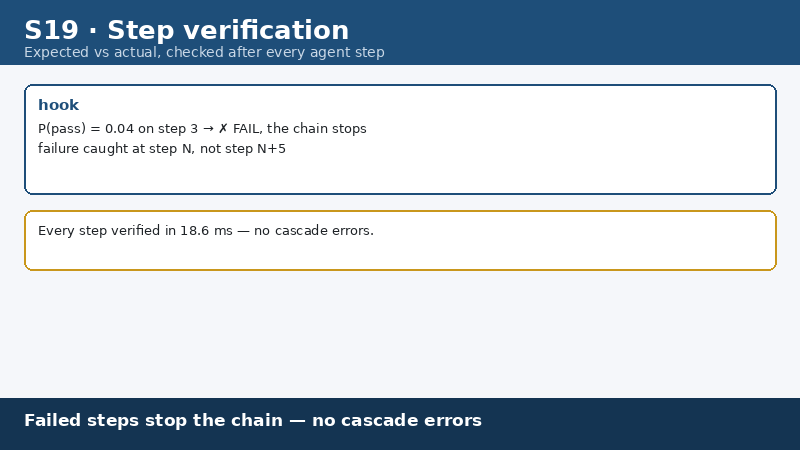

**S20 · output screening** — p(usable)=0.35 block saves LLM tokens · first coarse screen only

▶ Click to expand the demo GIF

  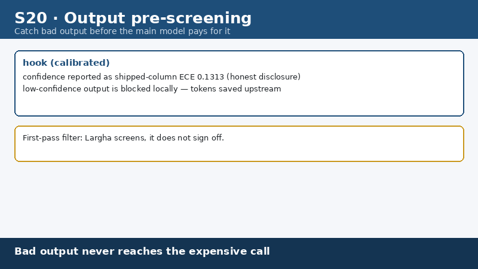

**S21 · content gate** — allow / review / block (0.30/0.65 dual thresholds) · gray band → human

▶ Click to expand the demo GIF

  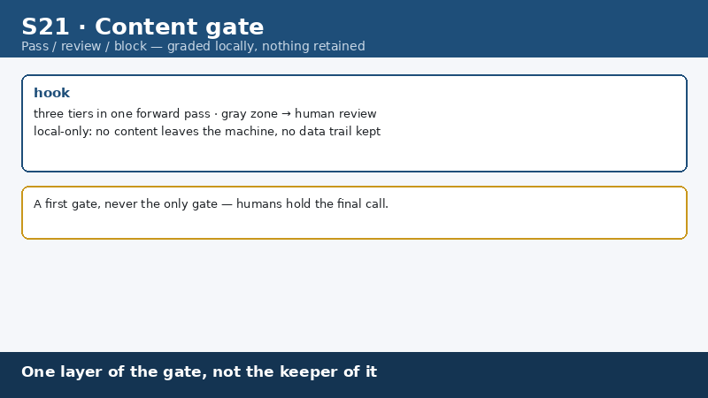

**S22 · option-order invariance** — flip rate 0.0217 — same verdict after option shuffle

▶ Click to expand the demo GIF

  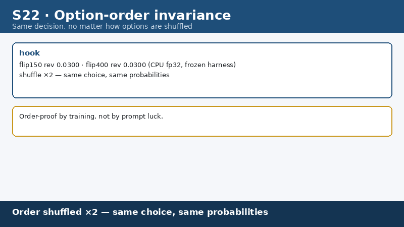

**S23 · bilingual decision** — typed acc en 0.906 / zh 0.848 · zh = translated cases

▶ Click to expand the demo GIF

  

**S24 · quickstart in three lines** — pip install → serve → POST · hardware tiers: 4 GB no-GPU 1.5–1.7 s / 3060-class 30–60 ms / 8 GB+ VRAM 21.0 ms (RTX 5090)

▶ Click to expand the demo GIF

  

### Head-to-head & reliability

**G25 · local vs API race** — 21.0 ms (RTX 5090) local vs 1.51 s API round-trip (our n=40; third-party Jev API single decision 238–301 ms)

▶ Click to expand the demo GIF

  

**G26 · token savings** — 100 decisions: 54 local / 46 escalated · −55.0% LLM calls (79.6% at τ=0.5)

▶ Click to expand the demo GIF

  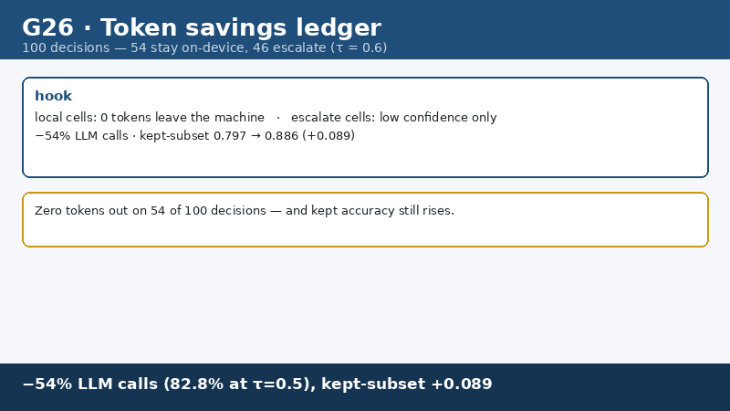

**G27 · fail-closed gate** — server unreachable → DENY by default, no silent pass

▶ Click to expand the demo GIF

  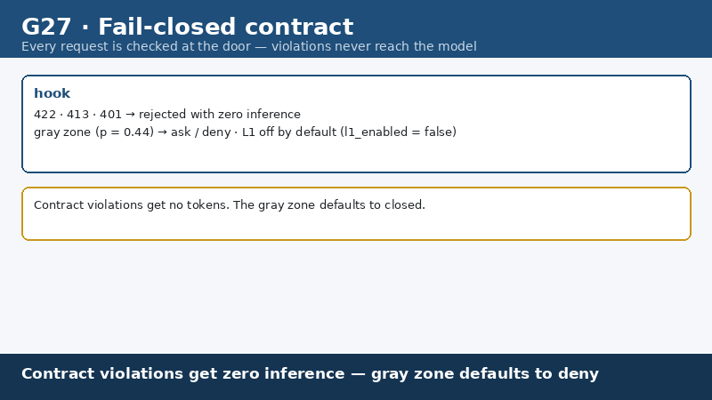

## Honest notes

- All demos are **synthesized** (fictional scenario data) for capability illustration — not real user data
- Thresholds shown in S04/S15/S21 are demo values; the shipped guard's thresholds are documented in [deployment.md](../deployment.md)
- In-frame numbers match [BENCHMARKS.md](../../BENCHMARKS.md); limitations (e.g. JevBench 0.5455, 58.4% gate not passed) are disclosed in [MODEL_CARD.md](../../MODEL_CARD.md)

## Demo → plugin coverage

A demo is a **capability illustration**; it is not the same thing as a tool you can drop
into a workflow. The table below says, for each of the 27 demos, whether a published
plugin implements it, whether it was measured and the verdict was *do not ship*, or
whether it is still unmeasured. Verify with `python tools/audit_gallery_coverage.py`,
which queries PyPI and npm rather than trusting the repositories.

| Status | Count | Demos |
|---|---|---|
| **Implemented by a published plugin** | 5 | S01 S02 S03 S04 S05 (the command-approval family) |
| **Measured, below the bar → not shipped** | 21 | S07 S09 S13 S14 S15 S16 S17 S18 S19 S20 S21 S22 S23 S06 G26 S24 S10 S11 G25 S08 S12 |
| **Measured, and it holds** | 1 | G27 (no silent allow when the service is unreachable) |
| **Not yet measured** | 0 | — (all 27 are accounted for) |

The "below the bar" entries rest on re-runnable labelled-set measurements, not opinion:

| Demos | Script | Result |
|---|---|---|
| S09 S20 context screening | `measure-screen.mjs` | a block containing the actual fix scored 0.323 (droppable); a nursery rhyme scored 0.691 |
| S01 S13 S14 S19 S21 classification | `feasibility-matrix.mjs` | all below their bar; **the command gate alone manages only 55%** |
| S18 invoice arithmetic | `measure-deterministic-first.mjs` | model **0/6**; plain arithmetic **6/6** |
| S07 S16 tool/skill routing | `measure-routing.mjs` | 8-way routing **2/12** against a random baseline of 1.5; 33-point position bias |
| S17 weekly-report gate | `measure-quality-gate.mjs` | **3/12 against 6/12 for doing nothing** — worse than no gate |
| S22 option-shuffle stability | `measure-variance-vs-order.mjs` | model is fully deterministic, yet rotating the options changes **4/12** decisions; flip rate 0.333 vs a stated 0.0217 |
| S23 bilingual parity | `measure-bilingual.mjs` | **58% of decisions change with the language**; EN 42%, ZH 67% (the gap between them is not established at n=12) |
| S15 expense pre-approval | `measure-expense-approval.mjs` | policy checks **14/14 with no model calls**; the model rejects **8/8** clean claims |
| S06 / G26 escalation gate | `measure-escalation-savings.mjs` | the mechanism reproduces (confidence separates right from wrong, 0.583 vs 0.445); the magnitude does not (escalates 68.8% against a stated 55% saving) |
| S24 S10 S11 G25 latency | `measure-latency.mjs` | CPU p50 **15.1 ms**, faster than the stated 21.0 ms on an RTX 5090; but latency scales with request size and microbatch amortisation is **13%**, not the 67% implied |
| S12 snake | `measure-snake.mjs` | greedy 46 food, random 10, **model 7** — the only measurement below the random baseline |
| S08 Chinese domain | answered from existing evidence | "runs locally with no outbound call" holds (it is a precondition of every measurement here); 0.855 falls inside the 95% CI of the Chinese sample already on record |
| G27 fail-closed | `measure_failclosed.py` | **13/13 assertions**: unreachable / HTTP 500 / missing fields all deny the grey zone with a readable reason, while whitelisted commands still pass offline |

Full write-ups with raw output: [Phocinae/dsh-phocinae-screen](https://github.com/Phocinae/dsh-phocinae-screen)
(marked `private`, so npm refuses to publish it — it exists to publish the negative results).
The Chinese edition, [README_cn.md](./README_cn.md), carries the same numbers plus the
per-family commentary; this English table is the summary and the counts are kept identical
by `tools/audit_bilingual_sync.py`.

In one sentence: **in these decision domains the model's discrimination is not good enough
to support a plugin that reaches a conclusion on the user's behalf.** The same stance
already appears in the model card's disclosed limitations and in `phocinae-guard` shipping
with L1 off by default.

> **Two further notes.** The latency family (S24 / S10 / S11 / G25) claims latency rather
> than decision quality, so it is counted separately: the model is genuinely fast — CPU
> p50 15.1 ms — but latency is a function of the request, and the microbatch saving is far
> smaller than stated.
>
> **G27 is the only claim that passes outright**, and it is independent of decision
> quality because it measures *degradation behaviour* rather than accuracy. Even if the
> model got every judgement wrong, refusing instead of guessing when the service is
> unavailable would still hold.

Checksums: see [SHA256SUMS](./SHA256SUMS).
